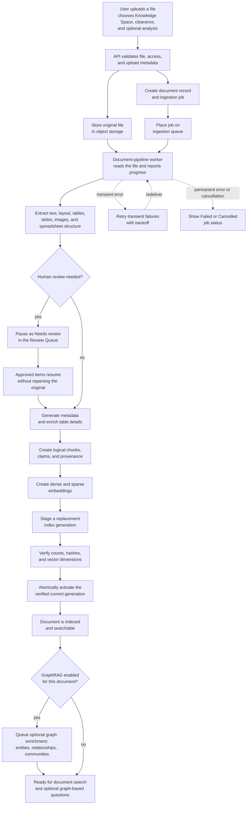
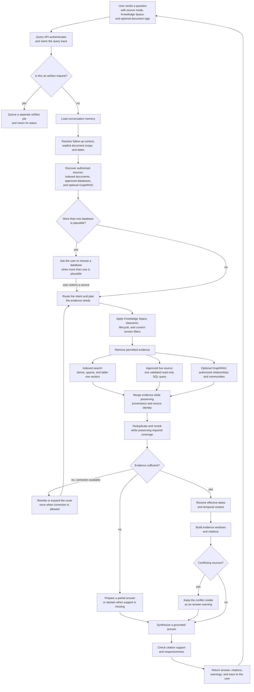

# Ingestion and Query Flows

These flowcharts show what happens after a user uploads a document and after a
user sends a question. The system keeps permissions, provenance, and review
status attached to the data throughout both flows.

## Document ingestion

[PNG export](diagrams/ingestion-flow.png) · [SVG export](diagrams/ingestion-flow.svg)

The original file is retained for provenance. Only the verified active index
generation is used for normal retrieval; older generations can remain available
for lifecycle and audit operations until they are retired.

## Question and answer retrieval

[PNG export](diagrams/query-flow.png) · [SVG export](diagrams/query-flow.svg)

The answer is streamed to the browser when streaming is enabled. Citations and
warnings let the user inspect the evidence, see conflicts, and recognize when
Prudentia could not support a complete answer.
